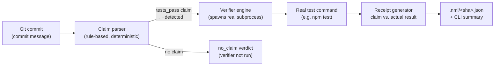

# nml


`nml` independently verifies "tests pass" claims made in git commits by re-running the project's tests and writing a shareable receipt — instead of trusting an AI coding agent's (or a human's) self-report.

## The problem

AI coding agents routinely report success — "tests pass", "added auth", "fixed the bug" — without anything independently checking that claim against the actual state of the system. The person or team relying on the agent has no cheap, fast way to know whether "done" means verified or just asserted.

This is not primarily a code-quality problem. It is a trust problem: the gap between what an agent says it did and what it actually did. That gap causes shipped bugs and wasted review time when a human has to manually re-check work the agent already claimed to have checked.

## Architecture

The pipeline is deliberately linear and has exactly one untrusted input (the commit message) and exactly one source of truth (a fresh subprocess run):



Two properties matter more than anything else in this design:

- **No cached or reported output is ever trusted.** The verifier always spawns a fresh subprocess and reads only its exit code and captured output. An agent's own "tests pass ✅" message never reaches the verdict.
- **No LLM grades the result.** Claim detection is regex/keyword-based, not model-based, and the pass/fail verdict comes from a process exit code, not from asking a model whether the code looks correct. This keeps the tool fast, free to run, and immune to the same class of self-report failure it's trying to catch.

## Why this is harder than it looks

- **False-positive guarding in claim detection.** "Tests pass through this middleware" is not a claim about test results. The parser has to distinguish incidental uses of the word "pass" from an actual status claim, without an LLM to lean on for disambiguation.
- **Trusting nothing about process state.** A verifier that shells out to run arbitrary test commands has to handle hung processes (timeout + full process-tree kill, not just the parent PID), missing commands, permission errors, and non-zero exits that aren't actually failures — all without crashing or silently reporting a false pass.
- **Confidence, not just detection.** "All tests pass" and "should be working now" are different claims. Collapsing them into one verdict would make the tool less useful than the vague self-report it's replacing — so low-confidence language is verified but flagged separately, never silently upgraded to a definitive claim.

## Why this design, not another one

- **Rule-based claim parsing over an LLM call.** An LLM-graded claim extractor would be more flexible but reintroduces exactly the failure mode this tool exists to remove — a model's judgment standing in for verified evidence. Regex/keyword matching is slower to generalize but deterministic, free, and auditable.
- **Commit messages over chat logs, first.** A commit message is the smallest reproducible unit tied to one exact repository state (the commit SHA). Chat transcripts are noisier, provider-specific, and harder to pin to a specific diff — a harder problem deliberately deferred rather than solved partially.
- **One claim type over general claim coverage.** "Tests pass" has an unambiguous, cheap, deterministic ground truth: an exit code. Claims like "added auth" or "fixed the bug" don't — verifying them needs a much broader evidence model, which is out of scope for a tool whose core promise is deterministic proof, not best-effort judgment.

## Prior art / how this differs

This project builds on an established evidence-and-gating pattern; it does not claim to invent that category.

- [MartinLoop](https://martinloop.com/) is a shipped CLI/MCP tool for running coding agents with budgets, verification gates, rollback/stop rules, and signed per-run receipts. `nml` is narrower and aimed at an individual developer or hackathon team: it starts from an existing git commit, extracts a claim from its message, and emits a simple receipt for that claim rather than governing an agent run or spend.
- [HORKOS](https://github.com/VeritasForge/demiurge) is part of the Demiurge tooling ecosystem and uses deterministic Claude Code evidence-audit hooks to block completion without proof. `nml` is a standalone git-focused CLI: its current integration is a pre-push hook, and its narrow differentiator is commit-message claim extraction plus a fresh test check.
- [EviBound](https://arxiv.org/abs/2511.05524) is an academic governance framework for autonomous research agents, using approval and post-execution evidence gates tied to queryable artifacts such as MLflow runs. `nml` targets local software repositories and a single claim type, "tests pass," rather than research workflow governance.

The practical scope difference is intentionally small: individual/hackathon-focused usage, commit-message claim extraction, and one claim type end-to-end. This is an incremental extension of a validated pattern, not a new category.

## Install

Requires Node.js 20 or newer and git.

The CLI is published to npm and can be installed globally with:

```bash
npm install -g @madhav_ms/nml-cli
```

After installation, use the `nml` command from any directory inside a git repository.

```bash
git clone https://github.com/VampiricCyborg/nml-cli.git
cd nml-cli
npm install
npm run build
npm link
```

For a local checkout without linking, use `node dist/cli.js` in the examples below.

## Quickstart

From any directory inside a git repository:

```bash
nml check
```

If `package.json` has a test script, `nml` infers `npm test`. To provide another command:

```bash
nml check --test-cmd "python -m pytest"
```

Check a single ref or all commits introduced by a branch:

```bash
nml check --commit HEAD
nml check --range main..feature-branch
nml check --range origin/main..HEAD --json
```

Commits without a tests-pass claim are skipped in range mode. Each claimed commit gets a receipt in `.nml/<short-sha>.json`.

Install the optional pre-push check:

```bash
nml install-hook
git push origin feature-branch
```

The hook checks commits about to be pushed and blocks a push when a claim produces `false_claim`. Git's normal bypass remains available for an intentional override:

```bash
git push --no-verify
```

Remove the managed hook with:

```bash
nml uninstall-hook
```

## Verdicts and receipts

- `verified`: a high-confidence tests-pass claim was followed by a passing fresh test run.
- `false_claim`: a high-confidence claim was followed by a failing or timed-out test run.
- `low_confidence_claim`: indirect language such as "CI is passing" was detected; the test result is recorded but the wording is intentionally not treated as a definitive claim.
- `no_claim`: no supported claim was found. In range mode, these commits do not create receipts.

Use `--json` for machine-readable output. Receipts include the commit SHA, extracted claim, test command/result, raw stdout/stderr, exit code, duration, verdict, and timestamp. Example receipt (`.nml/a1b2c3d.json`):

```json
{
  "commit": "a1b2c3d4e5f6",
  "claim": {
    "type": "tests_pass",
    "matchedText": "all tests pass",
    "sourceText": "Fix login redirect bug, all tests pass",
    "confidence": "high"
  },
  "verification": {
    "command": "npm test",
    "cwd": ".",
    "exitCode": 1,
    "passed": false,
    "timedOut": false,
    "durationMs": 4213,
    "stderr": "1 failing\n  1) LoginRedirect > should redirect after auth"
  },
  "verdict": "false_claim",
  "timestamp": "2026-08-20T09:14:02Z"
}
```

## Demo

A reproducible before/after terminal demo is in [`scripts/`](./scripts). It creates a temporary repository, makes an agent-authored commit claiming "tests pass", deliberately makes the test command fail, and shows `nml` returning `false_claim`.

```bash
npm run build
# macOS / Linux
bash scripts/demo-false-claim.sh
# Windows
powershell -ExecutionPolicy Bypass -File .\scripts\demo-false-claim.ps1
```

## Validation

Run manually against several personal repositories containing AI-agent-generated commits (Phase 5 of the build). Across the commits scanned, `nml` correctly separated genuine passing claims from commits where the claimed test status did not match a fresh run, and correctly skipped commits with no test-related claim rather than forcing a verdict. This was a small, self-run check, not a broader user study — see [Roadmap](#roadmap--deferred-work).

## Current scope and explicit non-goals

**In scope (MVP):**

- Parse claims from a single source type first — a git commit message or PR description (not full chat logs initially; that's harder and more novel, save for v2).
- Support one claim type end-to-end: **"tests pass."** Independently re-run the actual test suite fresh (ignore any reported output) and compare to the claim.
- Output a simple structured receipt: claim → verified/failed → evidence (raw test output or exit code).
- CLI tool, single language/framework target (Node.js/npm projects) for v1.

**Out of scope (MVP):**

- General claim types like "added auth" or "fixed the bug" (requires mapping arbitrary natural-language claims to arbitrary checks — hard, save for v2+).
- Budget/spend governance (MartinLoop's territory).
- Compliance/audit trail, cryptographic signing, multi-agent orchestration.
- IDE/agent-hook integration (Claude Code hooks, Cursor rules) — start as a standalone CLI, integrate later if it proves useful.
- Multi-language support beyond the first target stack.

**Explicit non-goal:** re-implementing MartinLoop, EviBound, or HORKOS. If, after reviewing their source, 70% of the MVP is already covered by an existing open-source tool, the right move is to extend/fork/build on top of it and clearly say so — not quietly reinvent it.

## Roadmap / deferred work

- **General claim types:** deferred until real usage shows that claims beyond "tests pass" are frequent and can be mapped to checks safely. Arbitrary claims such as "added auth" or "fixed the bug" need a substantially broader evidence model.
- **Chat-log parsing:** deferred because commit-message extraction is the smallest useful source boundary. Chat transcripts are noisier, provider-specific, and harder to associate with one reproducible repository state.
- **Budget governance:** deferred because spend caps, rollback, compliance, and multi-agent operations are already central to tools such as MartinLoop and outside this MVP's individual-builder focus.
- **IDE/agent integrations:** deferred until the standalone CLI and pre-push workflow validate demand; the next obvious integration should be chosen from observed usage rather than assumed.
- **Broader validation:** the current validation is a small self-run check across personal repos; a next step would be usage from a few outside hackathon/vibe-coder testers before investing further.

## Development

```bash
npm install
npm run build
npm run lint
npm test
```

CI runs the same build, lint, and test checks on pushes and pull requests.

## License

MIT
